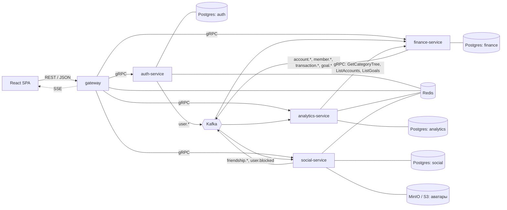
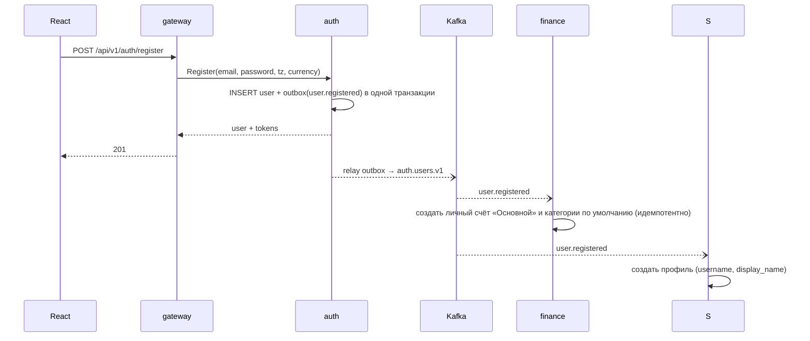
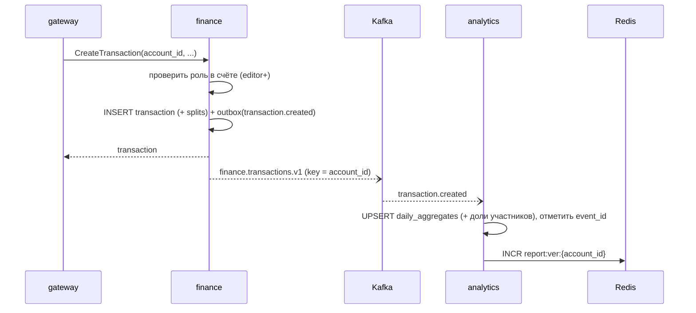

# 02 — Архитектура

## Общая схема



## Сервисы

| Сервис | Ответственность | Хранилища | Входы | Выходы |
|---|---|---|---|---|
| **gateway** | Единая точка для фронта: REST API, SSE-поток уведомлений, валидация JWT, rate limiting, CORS, маппинг REST ↔ gRPC | Redis (rate limit, Pub/Sub) | HTTP от React | gRPC в сервисы, SSE |
| **auth-service** | Пользователи, `username`, пароли, выпуск и ротация токенов, часовой пояс и валюта | Postgres `auth`, Redis (refresh-токены, лимиты входа) | gRPC | Kafka `auth.users.v1` |
| **finance-service** | Счета, участники и роли, приглашения, категории, транзакции, сплиты и расчёты, цели и взносы: источник истины по финансовым данным и правам на них | Postgres `finance` | gRPC, Kafka `auth.users.v1`, `social.v1` | Kafka `finance.accounts.v1`, `finance.transactions.v1`, `finance.goals.v1` |
| **analytics-service** | Агрегаты по счетам и долям участников, отчёты, рекомендации | Postgres `analytics`, Redis (кеш отчётов) | gRPC, Kafka `finance.*` | — |
| **social-service** | Профили, друзья, блокировки, лента, комментарии, реакции, уведомления | Postgres `social`, Redis (Pub/Sub), MinIO | gRPC, Kafka `auth.*`, `finance.*` | Kafka `social.v1`, Redis Pub/Sub |

Подробно про social-service и совместные счета — в [09-social.md](09-social.md).

### Почему так
- **finance отдельно от analytics.** Запись проста и транзакционна. Чтение отчётов — тяжёлые агрегации. Разделение позволяет держать отчёты на предрасчитанных агрегатах и не нагружать основную БД. Заодно это естественный повод для Kafka.
- **gateway без бизнес-логики.** Он только аутентифицирует, ограничивает и проксирует. Пользователь (`user_id`) передаётся в сервисы через gRPC metadata, а сервисы доверяют только gateway (внутренняя сеть или mTLS).
- **Права на счёт проверяет finance.** Владелец данных знает, кто к ним допущен. gateway роли не проверяет, а social и analytics используют реплику участников из событий `finance.accounts.v1` или синхронный `CheckAccess`.
- **social отдельно от finance.** Соцфункции (лента, комментарии, уведомления) много пишут и читают, но к деньгам доступа не имеют. Сбой social не мешает вести учёт.
- **У каждого сервиса своя схема (БД).** Никаких JOIN между сервисами: данные получаются через gRPC или события.

> **Упрощение.** Если микросервисы начнут тормозить разработку, auth и finance можно собрать в один бинарь (модульный монолит) с теми же пакетами в `internal/`. Границы модулей при этом сохраняются, и разделение позже станет механическим.

## Ключевые потоки

### Регистрация



(`S` — social-service.)

### Создание транзакции и обновление отчёта



Для совместного счёта то же событие читает social: он создаёт записи в ленте участников и уведомления (см. [09-social.md](09-social.md#лента-комментарии-уведомления)).

### Построение отчёта

1. gateway вызывает `analytics.GetSummaryReport(account_ids, from, to, granularity)`.
2. analytics проверяет, что пользователь участник всех запрошенных счетов (реплика участников), и считает ключ кеша `report:{user_id}:{hash(versions счетов)}:{hash(params)}`. При попадании ответ сразу возвращается.
3. При промахе: агрегаты за период и за предыдущий период такой же длины, дерево категорий (`finance.GetCategoryTree`, кешируется), цели (`finance.ListGoals`).
4. Движок рекомендаций прогоняет правила, результат кладётся в Redis с TTL 10 мин.

## Надёжность событий

- **Transactional outbox.** Событие пишется в таблицу `outbox` в той же транзакции, что и данные. Отдельная горутина-релей читает `outbox` (`FOR UPDATE SKIP LOCKED`), публикует в Kafka и помечает запись отправленной. Двойной записи «БД + Kafka» в обработчике запроса нет.
- **At-least-once + идемпотентные консьюмеры.** У каждого события есть `event_id` (UUID). Консьюмер в одной транзакции применяет изменения и вставляет `event_id` в `processed_events`. Если запись уже есть, событие пропускается.
- **Порядок.** Ключ сообщения финансовых событий — `account_id`, пользовательских — `user_id`. События одного счёта попадают в одну партицию и обрабатываются по порядку.
- **Ошибки.** После N неудачных попыток сообщение уходит в `<topic>.dlq`, а консьюмер продолжает работу.
- **Пересборка.** analytics умеет пересчитать агрегаты счёта с нуля через `finance.StreamTransactions`. Это нужно после смены часового пояса счёта и при багах в агрегации.

## Структура репозитория

Монорепозиторий, один Go-модуль `github.com/famineBurgund/graspy`.

```
.
├── cmd/
│   ├── gateway/main.go
│   ├── auth/main.go
│   ├── finance/main.go
│   ├── analytics/main.go
│   └── social/main.go
├── internal/
│   ├── gateway/               # http-хендлеры, middleware, маппинг в gRPC
│   ├── auth/
│   │   ├── domain/            # сущности, доменные ошибки (без зависимостей)
│   │   ├── service/           # use-cases, интерфейсы репозиториев
│   │   ├── repository/        # postgres / redis реализации
│   │   ├── transport/grpc/    # gRPC-сервер
│   │   └── events/            # outbox, продюсер
│   ├── finance/               # та же раскладка + consumer/
│   ├── analytics/             # та же раскладка + aggregator/, rules/
│   ├── social/                # та же раскладка + feed/, notify/
│   └── platform/              # общая инфраструктура, без бизнес-логики
│       ├── config/
│       ├── logger/            # slog setup, context helpers
│       ├── postgres/          # pgxpool, tx manager
│       ├── redis/
│       ├── kafka/             # producer, consumer group, outbox relay
│       ├── grpcx/             # интерсепторы: логи, recovery, user_id из metadata
│       ├── httpx/             # JSON-ответы, ошибки, middleware
│       └── money/             # тип Money и операции
├── api/proto/graspy/          # .proto файлы
│   ├── auth/v1/
│   ├── finance/v1/
│   ├── analytics/v1/
│   ├── social/v1/
│   └── events/v1/
├── gen/go/                    # сгенерированный код (buf generate)
├── migrations/
│   ├── auth/
│   ├── finance/
│   ├── analytics/
│   └── social/
├── web/                       # React-приложение
├── deploy/
│   ├── docker-compose.yml
│   └── k8s/                   # манифесты / helm chart
├── docs/
├── Makefile
└── buf.yaml
```

### Правила зависимостей
- `domain` ни от чего не зависит.
- `service` зависит от `domain` и от **интерфейсов**, которые сам объявляет (репозитории, публикатор событий, часы).
- `repository`, `transport` и `events` зависят от `service` и `domain` и реализуют интерфейсы.
- `internal/<service>` не импортирует другой `internal/<service>`: связь только через `gen/go` (gRPC-клиенты) и события.
- Сборка зависимостей (wiring) делается вручную в `cmd/<service>/main.go`, без DI-фреймворков.

## Фронтенд

- React + TypeScript, Vite.
- Данные: TanStack Query. Состояние сервера не дублируется в глобальном сторе.
- Роутинг: React Router. Страницы: вход/регистрация, дашборд (главный отчёт), счета, транзакции, категории, цели, совместный счёт (участники, лента, балансы), друзья, профиль, уведомления, настройки.
- Переключатель счёта в шапке: «Все личные» / конкретный счёт. Выбранный счёт задаёт контекст для транзакций, категорий, целей и отчёта.
- Уведомления: `EventSource` на `/api/v1/events/stream`, событие инвалидирует нужные запросы TanStack Query.
- Графики: Recharts или ECharts.
- Токены: access хранится в памяти, refresh — в `httpOnly; Secure; SameSite=Strict` cookie, которую выставляет gateway. Так токен недоступен из JS.
- Типы API генерируются из OpenAPI-спеки gateway (`openapi-typescript`).
