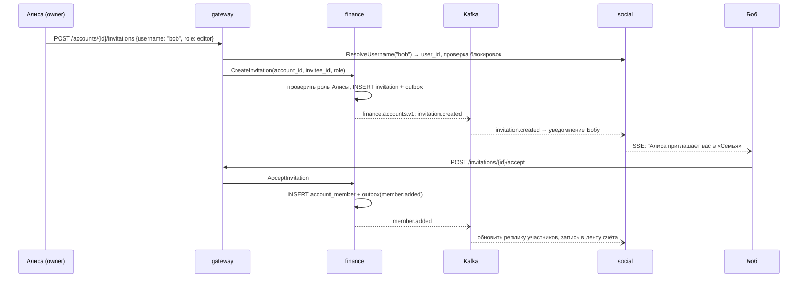
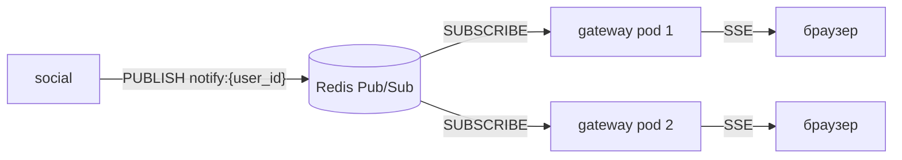

# 09 — Совместные счета и социальные функции

Этот документ описывает всё, что выходит за рамки «один человек ведёт свой бюджет»: совместные счета, приглашения, друзей, ленту, комментарии, уведомления и разделение расходов.

Базовое понятие **счёта** (личного и совместного) и проверка доступа к нему описаны в [03-domain.md](03-domain.md#счета-и-доступ), потому что на них опираются транзакции, отчёты и цели с самого начала.

## Сценарии

| # | Сценарий |
|---|---|
| S-1 | Пара ведёт общий семейный бюджет: оба добавляют расходы, видят общий отчёт и копят на общую цель |
| S-2 | Соседи по квартире делят коммуналку и продукты и видят, кто кому сколько должен |
| S-3 | Друзья копят на совместную поездку: у каждого виден личный вклад в цель |
| S-4 | Пользователь делится с друзьями достижением («Закрыл цель "Подушка"»), не раскрывая суммы |
| S-5 | Участник комментирует спорную трату в общем счёте, другие получают уведомление |

## Функциональные требования

### FR-7. Совместные счета
- Пользователь создаёт совместный счёт (название, валюта, часовой пояс) и становится его владельцем (`owner`).
- Участников добавляют через приглашение: по `@username`, из списка друзей или по ссылке.
- Роли: `owner`, `editor`, `viewer` (матрица прав ниже). В счёте не больше 10 участников.
- У совместного счёта свой набор категорий. При создании он копируется из шаблона по умолчанию, дальше им управляют владелец и редакторы.
- Отчёт и рекомендации по совместному счёту видят все участники.
- Участник может выйти из счёта сам. Владелец может удалить участника или передать владение. Владелец не может выйти, пока не передал владение или не архивировал счёт.
- Транзакции ушедшего участника остаются в счёте, автор отображается как «бывший участник».

### FR-8. Совместные цели
- Цель, созданная в совместном счёте, общая. Взносы делают участники с ролью `editor` и выше.
- Прогресс цели показывается общим и с разбивкой по участникам.

### FR-9. Разделение расходов (опционально для счёта)
- Режим счёта `split_mode`:
  - `none` — общий кошелёк: учитывается, кто внёс трату, но долги не считаются;
  - `equal` — каждая трата по умолчанию делится поровну между участниками;
  - `custom` — доли задаются в каждой транзакции.
- У траты есть плательщик (по умолчанию автор) и доли участников.
- Для счёта показываются балансы: кто кому должен, с минимизацией числа переводов.
- Возврат долга оформляется транзакцией-расчётом (`settlement`). В доходы и расходы она не входит.
- В личный отчёт пользователя по желанию включается **его доля** трат совместных счетов (`include_shared=true`).

### FR-10. Профиль и друзья
- У каждого пользователя есть уникальный `@username` (задаётся при регистрации, можно сменить раз в 30 дней), отображаемое имя и аватар.
- Поиск людей по `@username` (точное совпадение или префикс от 3 символов).
- Заявки в друзья: отправить, принять, отклонить, отменить, удалить из друзей.
- Блокировка: заблокированный не находит пользователя в поиске и не может слать ему заявки, приглашения и упоминания.

### FR-11. Лента и взаимодействия
- **Лента счёта:** события внутри совместного счёта (новая трата, комментарий, вступил участник, цель достигнута). Видна только участникам.
- **Лента друзей:** достижения, которыми пользователь явно поделился (цель закрыта, норма сбережений ≥ 20% за месяц, серия из N месяцев без перерасхода). По умолчанию выключена.
- **Комментарии** к транзакциям и целям совместного счёта, с поддержкой упоминаний `@username` участников.
- **Реакции** (фиксированный набор эмодзи) на транзакции, комментарии и записи ленты.

### FR-12. Уведомления
- Хранятся в приложении (центр уведомлений с непрочитанными) и доставляются в реальном времени через SSE.
- Типы: заявка в друзья, приглашение в счёт, вступление или выход участника, упоминание, комментарий к моей транзакции, реакция, цель достигнута, напоминание о долге.
- Пользователь настраивает, какие типы получать. Для «новая трата в общем счёте» по умолчанию стоит дайджест раз в день, а не отдельное уведомление на каждую трату.

## Приватность

Главный принцип: **финансовые данные видят только участники счёта**. Дружба сама по себе доступа к деньгам не даёт.

| Данные | Кто видит |
|---|---|
| Транзакции, суммы, категории, отчёты личного счёта | Только владелец |
| То же для совместного счёта | Участники счёта |
| `@username`, имя, аватар | Зависит от настройки `profile_visibility`: `everyone` / `friends` / `nobody` (в поиске) |
| Список друзей | Только сам пользователь |
| Достижения в ленте друзей | Друзья, если включено. Суммы скрыты по умолчанию, показываются проценты |

- Включить шаринг достижений можно только явным действием, по умолчанию он выключен.
- Аватары отдаются через подписанные URL с ограниченным сроком жизни.
- Удаление аккаунта: пользователь выходит из всех совместных счетов. В счетах, где он владелец, владение переходит к самому давнему `editor`, а если такого нет — счёт архивируется. Профиль, комментарии и реакции анонимизируются.

## Роли и права

| Действие | owner | editor | viewer |
|---|:-:|:-:|:-:|
| Просмотр транзакций, отчётов, целей, ленты | ✅ | ✅ | ✅ |
| Комментарии и реакции | ✅ | ✅ | ✅ |
| Создание транзакций и взносов в цели | ✅ | ✅ | — |
| Изменение и удаление **своих** транзакций | ✅ | ✅ | — |
| Изменение и удаление **чужих** транзакций | ✅ | — | — |
| Управление категориями и целями | ✅ | ✅ | — |
| Приглашение участников | ✅ | ✅ (только роли `editor`/`viewer`) | — |
| Смена ролей, удаление участников | ✅ | — | — |
| Изменение настроек счёта (`split_mode`, название, часовой пояс) | ✅ | — | — |
| Передача владения, архивация счёта | ✅ | — | — |
| Удаление своего комментария | ✅ | ✅ | ✅ |
| Удаление чужого комментария | ✅ | — | — |

Проверка прав выполняется **в сервисе-владельце данных** (finance для финансовых данных, social для комментариев и ленты), а не в gateway.

## Приглашения

```
AccountInvitation {
  id, account_id, inviter_id,
  invitee_id?            // приглашение конкретного пользователя
  token_hash?            // приглашение по ссылке
  role (editor|viewer),
  status (pending|accepted|declined|revoked|expired),
  expires_at, created_at
}
```

- Приглашение по `@username`: создаётся с `invitee_id`, адресат получает уведомление и принимает или отклоняет его.
- Приглашение по ссылке: `https://<host>/invite/<token>`, токен — 32 случайных байта, в БД хранится SHA-256. TTL 7 дней, одноразовое. Принять его может любой залогиненный пользователь, кроме заблокированных владельцем.
- Нельзя пригласить того, кто уже в счёте, у кого уже есть активное приглашение в этот счёт или кто заблокировал приглашающего. Во всех этих случаях ответ одинаковый, чтобы по нему нельзя было узнать, кто кого заблокировал.
- Лимиты: не больше 20 приглашений и 30 заявок в друзья в сутки на пользователя.



## Разделение расходов

### Модель
```
TransactionSplit { transaction_id, user_id, amount }   // доля участника, сумма долей = amount
Transaction.paid_by                                     // кто фактически заплатил (участник счёта)
```

- При `split_mode = equal` сервис раскладывает сумму поровну между **текущими** участниками с ролью `editor` и выше, если клиент не прислал доли явно.
- Остаток копеек от деления распределяется по одной копейке первым участникам в порядке `user_id`. Так раскладка детерминирована.
- Сумма долей всегда равна `amount`. Это проверяется в сервисе и constraint-триггером.

### Баланс
```
balance[u] = Σ amount трат, где paid_by = u
           − Σ split.amount, где user_id = u
           + Σ settlement, где u отправитель
           − Σ settlement, где u получатель
```
`balance > 0` значит, что участнику должны, `< 0` — что должен он. Сумма балансов по счёту равна 0, это инвариант, его стоит проверять в тестах.

**Упрощение долгов.** Для показа «кто кому» должники и кредиторы сортируются по модулю баланса, после чего наибольший долг жадно гасится наибольшим кредитом. Получается не больше `N − 1` переводов, для ≤ 10 участников этого достаточно.

### Расчёт (settlement)
- Транзакция `kind = settlement`: `paid_by` — кто отдаёт, единственная доля — кто получает.
- Не имеет категории и не входит в доход или расход отчёта.
- Подтверждается получателем. До подтверждения она `pending` и не меняет баланс. Так нельзя «погасить» долг без ведома кредитора.

## Лента, комментарии, уведомления

### Хранение ленты
- **Fan-out on write:** при событии запись добавляется в `feed_items` каждого получателя. В счёте ≤ 10 участников, а у пользователя ограниченное число друзей (≤ 500), поэтому это дёшево, а чтение ленты сводится к одному индексу.
- Запись ленты ссылается на объект (`object_type`, `object_id`) и хранит **снимок** для отображения: имя автора, категорию, сумму. Ленте не нужно ходить в finance при чтении.
- После удаления транзакции её запись в ленте скрывается по событию `transaction.deleted`.
- Записи старше 180 дней удаляются фоновой задачей.

### Комментарии и права
- social хранит **реплику участников счетов** (`account_members_replica`), которую обновляет по событиям `finance.accounts.v1`. По ней проверяется право комментировать и формируются получатели fan-out.
- Реплика обновляется с небольшой задержкой (eventual consistency): удалённый участник ещё несколько секунд может оставить комментарий. Для пет-проекта это приемлемо. Для строгой проверки можно вызывать `finance.CheckAccess` синхронно.
- Упоминание `@username` создаёт уведомление, только если упомянутый — участник счёта.

### Реальное время

- Фронт открывает `GET /api/v1/events/stream` (SSE). Gateway подписывается на `notify:{user_id}` для каждого своего подключённого пользователя.
- Pub/Sub не гарантирует доставку. Источник истины — таблица `notifications`. При переподключении фронт передаёт `Last-Event-ID`, и gateway догружает пропущенное через `social.ListNotifications(after_id)`.
- Heartbeat-комментарий отправляется каждые 25 с, чтобы ingress не рвал соединение.

## Архитектура

Добавляется **social-service**.

| | |
|---|---|
| Ответственность | Профили (кроме `username`, он хранится в auth), друзья, блокировки, лента, комментарии, реакции, уведомления и их настройки |
| Хранилища | Postgres `graspy_social`, Redis (Pub/Sub, кеш профилей), S3-совместимое хранилище (MinIO) для аватаров |
| Входы | gRPC от gateway; Kafka `auth.users.v1`, `finance.accounts.v1`, `finance.transactions.v1`, `finance.goals.v1` |
| Выходы | Kafka `social.v1` (запрос дружбы, принятие, блокировка — нужно finance для проверки блокировок при приглашениях), Redis Pub/Sub |

Совместные счета, участники, приглашения и разделение расходов живут в **finance**: это финансовые данные, и права на них должен проверять их владелец.

## API

### REST (gateway)

**Счета и участники** (finance):
| Метод | Путь | Описание |
|---|---|---|
| GET | `/accounts/{id}/members` | Участники с ролями |
| PATCH | `/accounts/{id}/members/{user_id}` | `{role}` — только owner |
| DELETE | `/accounts/{id}/members/{user_id}` | Удалить участника (owner) или выйти самому (свой `user_id`) |
| POST | `/accounts/{id}/transfer-ownership` | `{user_id}` |
| POST | `/accounts/{id}/invitations` | `{username, role}` или `{role, link: true}` → для ссылки возвращается `url` |
| GET | `/accounts/{id}/invitations` | Активные приглашения счёта |
| DELETE | `/accounts/{id}/invitations/{inv_id}` | Отозвать |
| GET | `/invitations` | Входящие приглашения |
| POST | `/invitations/{id}/accept` / `decline` | |
| POST | `/invitations/by-token/{token}/accept` | Принять по ссылке |
| GET | `/accounts/{id}/balances` | Балансы и «кто кому» (при `split_mode ≠ none`) |
| POST | `/accounts/{id}/settlements` | `{to_user_id, amount}` |
| POST | `/accounts/{id}/settlements/{tx_id}/confirm` | Подтверждение получателем |

Транзакции в совместном счёте принимают дополнительные поля: `paid_by?`, `splits?: [{user_id, amount}]`.

**Социальное** (social):
| Метод | Путь | Описание |
|---|---|---|
| GET / PATCH | `/profile` | Свой профиль: `display_name`, `bio`, настройки приватности |
| POST | `/profile/avatar` | Возвращает presigned PUT URL. После загрузки клиент вызывает `PATCH /profile {avatar_key}` |
| GET | `/users/{username}` | Публичный профиль с учётом приватности |
| GET | `/users/search?q=` | Поиск по префиксу username |
| GET | `/friends` | Друзья |
| GET | `/friends/requests?direction=incoming\|outgoing` | Заявки |
| POST | `/friends/requests` | `{username}` |
| POST | `/friends/requests/{id}/accept` / `decline`, DELETE — отменить | |
| DELETE | `/friends/{user_id}` | Удалить из друзей |
| POST / DELETE | `/blocks/{user_id}` | Заблокировать / разблокировать |
| GET | `/feed?scope=friends` / `/accounts/{id}/feed` | Лента, курсорная пагинация |
| GET / POST | `/accounts/{id}/{object_type}/{object_id}/comments` | `object_type`: `transactions` / `goals` |
| DELETE | `/comments/{id}` | |
| PUT / DELETE | `/reactions/{object_type}/{object_id}` | `{emoji}` — одна реакция пользователя на объект |
| GET | `/notifications?unread=true` | |
| POST | `/notifications/read` | `{ids}` или `{all: true}` |
| GET / PATCH | `/notifications/settings` | |
| POST | `/achievements/share` | Поделиться достижением в ленте друзей |
| GET | `/events/stream` | SSE |

### gRPC
```protobuf
// finance/v1/accounts.proto
service AccountService {
  rpc CreateAccount(CreateAccountRequest) returns (Account);
  rpc ListAccounts(ListAccountsRequest) returns (ListAccountsResponse);
  rpc UpdateAccount(UpdateAccountRequest) returns (Account);
  rpc CheckAccess(CheckAccessRequest) returns (CheckAccessResponse); // role или NotFound
  rpc ListMembers(ListMembersRequest) returns (ListMembersResponse);
  rpc UpdateMemberRole(UpdateMemberRoleRequest) returns (Member);
  rpc RemoveMember(RemoveMemberRequest) returns (google.protobuf.Empty);
  rpc TransferOwnership(TransferOwnershipRequest) returns (Account);
  rpc CreateInvitation(CreateInvitationRequest) returns (Invitation);
  rpc AcceptInvitation(AcceptInvitationRequest) returns (Member);
  rpc DeclineInvitation(DeclineInvitationRequest) returns (google.protobuf.Empty);
  rpc RevokeInvitation(RevokeInvitationRequest) returns (google.protobuf.Empty);
  rpc GetBalances(GetBalancesRequest) returns (Balances);
}

// social/v1/social.proto
service ProfileService { rpc GetProfile(...); rpc UpdateProfile(...); rpc ResolveUsername(...); rpc Search(...); }
service FriendService  { rpc SendRequest(...); rpc Respond(...); rpc List(...); rpc Remove(...); rpc Block(...); rpc IsBlocked(...); }
service FeedService    { rpc ListFeed(...); rpc ShareAchievement(...); }
service CommentService { rpc Create(...); rpc List(...); rpc Delete(...); rpc React(...); }
service NotificationService { rpc List(...); rpc MarkRead(...); rpc GetSettings(...); rpc UpdateSettings(...); }
```

### Kafka

| Топик | Продюсер | Консьюмеры | Ключ |
|---|---|---|---|
| `finance.accounts.v1` | finance | social, analytics | `account_id` |
| `social.v1` | social | finance | `user_id` |

| Событие | Payload |
|---|---|
| `account.created` / `account.updated` / `account.archived` | `{account}` |
| `member.added` / `member.removed` / `member.role_changed` | `{account_id, user_id, role, by_user_id}` |
| `ownership.transferred` | `{account_id, from, to}` |
| `invitation.created` / `invitation.accepted` / `invitation.declined` | `{invitation}` (без токена) |
| `settlement.created` / `settlement.confirmed` | `{account_id, from, to, amount}` |
| `friendship.created` / `friendship.removed` | `{user_a, user_b}` |
| `user.blocked` / `user.unblocked` | `{blocker_id, blocked_id}` |
| `comment.created` | `{comment_id, account_id, object_type, object_id, author_id, mentions[]}` |

## Данные (social)

```sql
CREATE TABLE profiles (
    user_id             uuid PRIMARY KEY,
    username            text NOT NULL,         -- реплика из auth
    display_name        text NOT NULL,
    bio                 text,
    avatar_key          text,
    profile_visibility  text NOT NULL DEFAULT 'friends',
    share_achievements  boolean NOT NULL DEFAULT false,
    updated_at          timestamptz NOT NULL DEFAULT now()
);
CREATE UNIQUE INDEX profiles_username_uq ON profiles (lower(username));
CREATE INDEX profiles_username_prefix_idx ON profiles (lower(username) text_pattern_ops);

CREATE TABLE friend_requests (
    id            uuid PRIMARY KEY,
    from_user_id  uuid NOT NULL,
    to_user_id    uuid NOT NULL,
    status        text NOT NULL DEFAULT 'pending',  -- pending | accepted | declined | cancelled
    created_at    timestamptz NOT NULL DEFAULT now(),
    CHECK (from_user_id <> to_user_id)
);
CREATE UNIQUE INDEX friend_requests_pending_uq
    ON friend_requests (LEAST(from_user_id, to_user_id), GREATEST(from_user_id, to_user_id))
    WHERE status = 'pending';

CREATE TABLE friendships (                  -- одна строка на пару, user_a < user_b
    user_a      uuid NOT NULL,
    user_b      uuid NOT NULL,
    created_at  timestamptz NOT NULL DEFAULT now(),
    PRIMARY KEY (user_a, user_b),
    CHECK (user_a < user_b)
);
CREATE INDEX friendships_b_idx ON friendships (user_b);

CREATE TABLE blocks (
    blocker_id  uuid NOT NULL,
    blocked_id  uuid NOT NULL,
    created_at  timestamptz NOT NULL DEFAULT now(),
    PRIMARY KEY (blocker_id, blocked_id)
);

CREATE TABLE account_members_replica (
    account_id  uuid NOT NULL,
    user_id     uuid NOT NULL,
    role        text NOT NULL,
    PRIMARY KEY (account_id, user_id)
);
CREATE INDEX account_members_replica_user_idx ON account_members_replica (user_id);

CREATE TABLE feed_items (
    id           uuid PRIMARY KEY,            -- UUIDv7: сортировка по времени
    owner_id     uuid NOT NULL,               -- чья это лента
    scope        text NOT NULL,               -- account | friends
    account_id   uuid,
    actor_id     uuid NOT NULL,
    verb         text NOT NULL,               -- transaction_added, goal_achieved, member_joined, ...
    object_type  text NOT NULL,
    object_id    uuid NOT NULL,
    snapshot     jsonb NOT NULL,
    hidden       boolean NOT NULL DEFAULT false,
    created_at   timestamptz NOT NULL DEFAULT now()
);
CREATE INDEX feed_items_owner_idx ON feed_items (owner_id, scope, id DESC) WHERE NOT hidden;
CREATE INDEX feed_items_object_idx ON feed_items (object_type, object_id);

CREATE TABLE comments (
    id           uuid PRIMARY KEY,
    account_id   uuid NOT NULL,
    object_type  text NOT NULL,
    object_id    uuid NOT NULL,
    author_id    uuid NOT NULL,
    body         text NOT NULL CHECK (length(body) BETWEEN 1 AND 2000),
    created_at   timestamptz NOT NULL DEFAULT now(),
    edited_at    timestamptz,
    deleted_at   timestamptz
);
CREATE INDEX comments_object_idx ON comments (object_type, object_id, created_at);

CREATE TABLE reactions (
    object_type  text NOT NULL,
    object_id    uuid NOT NULL,
    user_id      uuid NOT NULL,
    emoji        text NOT NULL,
    created_at   timestamptz NOT NULL DEFAULT now(),
    PRIMARY KEY (object_type, object_id, user_id)
);

CREATE TABLE notifications (
    id          bigserial PRIMARY KEY,        -- монотонный, используется как SSE Last-Event-ID
    user_id     uuid NOT NULL,
    type        text NOT NULL,
    payload     jsonb NOT NULL,
    read_at     timestamptz,
    created_at  timestamptz NOT NULL DEFAULT now()
);
CREATE INDEX notifications_user_idx ON notifications (user_id, id DESC);
CREATE INDEX notifications_unread_idx ON notifications (user_id) WHERE read_at IS NULL;

CREATE TABLE notification_settings (
    user_id   uuid NOT NULL,
    type      text NOT NULL,
    channel   text NOT NULL DEFAULT 'instant',  -- instant | digest | off
    PRIMARY KEY (user_id, type)
);

-- + processed_events, outbox
```

Redis (social / gateway):

| Ключ | Назначение |
|---|---|
| `notify:{user_id}` | Pub/Sub-канал уведомлений |
| `profile:{user_id}` | Кеш профиля, 10 мин |
| `ratelimit:friend_req:{user_id}`, `ratelimit:invite:{user_id}`, `ratelimit:comment:{user_id}` | Суточные и минутные лимиты |
| `sse:conn:{user_id}` | Счётчик открытых SSE-соединений, не больше 5 на пользователя |

## Что обязательно протестировать
- Матрицу прав: каждое действие из таблицы для каждой роли и для «не участника» (ожидается `NotFound`, а не `Forbidden`, чтобы не раскрывать существование счёта).
- Инвариант `Σ balance = 0` после любых операций, включая удаление транзакций и выход участника.
- Распределение копеек при `equal`-сплите (например, 100,00 ₽ на троих).
- Блокировки: заблокированный не находит, не приглашает, не упоминает.
- Отсутствие утечек: лента друзей не содержит сумм, если пользователь не разрешил их показывать.
- Повторная доставка событий не создаёт дубли в ленте и уведомлениях.
